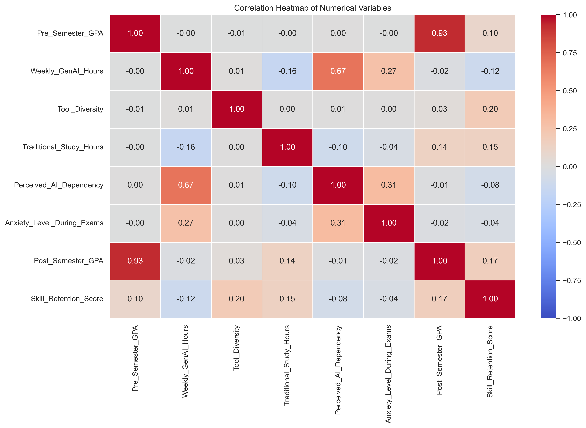
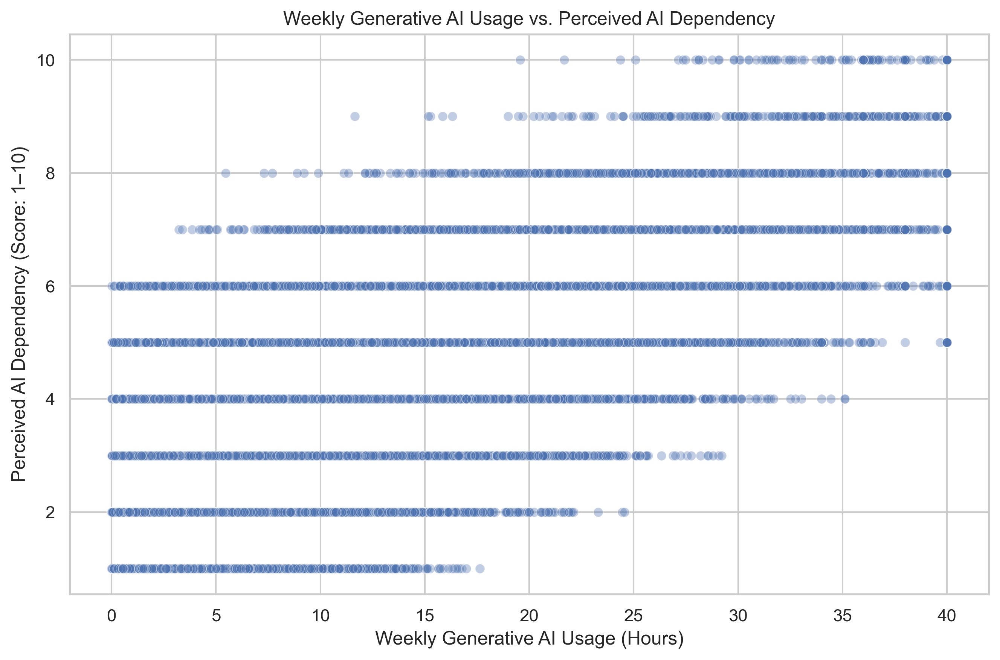
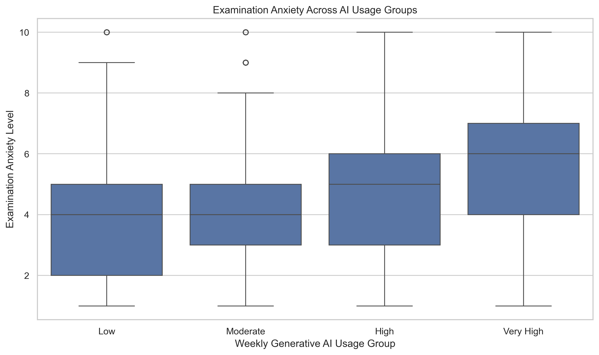
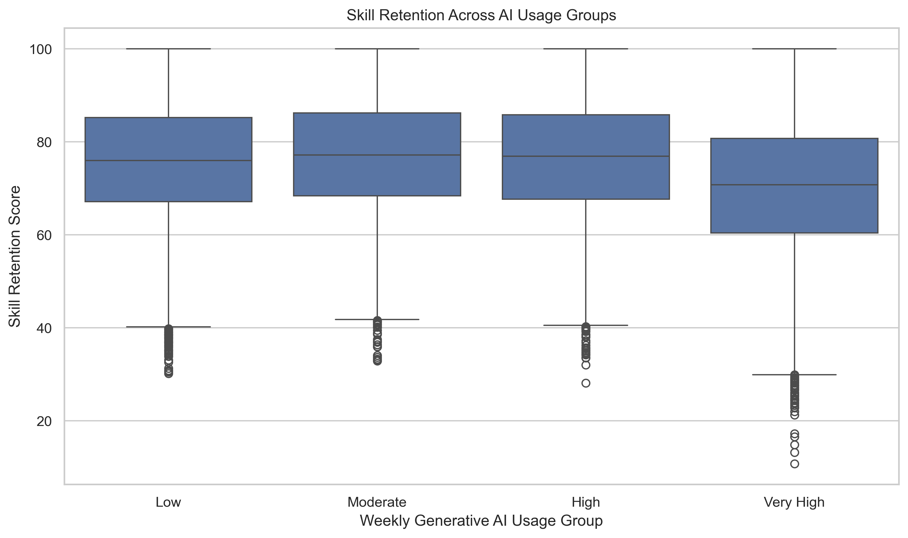

# AI-Student-Insights 📊

## Exploratory Data Analysis of Generative AI Usage and Student Outcomes

### 📌 Project Overview

**AI-Student-Insights** is a data analysis project that explores patterns in generative artificial intelligence (AI) usage among students and examines how these patterns relate to academic performance, traditional study habits, perceived AI dependency, examination anxiety, skill retention, and burnout risk.

The project uses Python-based Exploratory Data Analysis (EDA) techniques to inspect data quality, summarize variables, identify statistical relationships, and communicate findings through visualizations.

### 🎯 Objectives

* Understand student generative AI usage patterns.
* Examine pre-semester and post-semester GPA distributions.
* Investigate the relationship between AI usage and perceived AI dependency.
* Explore associations between AI usage, traditional study hours, and examination anxiety.
* Compare skill-retention scores across AI usage groups.
* Investigate AI usage patterns across burnout-risk categories.
* Present findings through clear statistical summaries and visualizations.

### 📂 Project Structure

```text
AI-Student-Insights/
├── data/
│   ├── raw/
│   │   └── ai_student_impact_dataset.csv
│   └── processed/
│       └── ai_student_impact_processed.csv
├── notebooks/
│   └── student_ai_usage_eda.ipynb
├── images/
│   └── visualizations/
├── reports/
│   └── EDA-REPORT.pdf
├── generate_eda_report.py
├── requirements.txt
└── README.md
```

### 🗃️ Dataset Description

The dataset contains **50,000 student records** and includes variables related to:

* Major and year of study
* Pre-semester and post-semester GPA
* Weekly generative AI usage hours
* Primary AI use case
* Prompt-engineering skill
* AI tool diversity and paid subscriptions
* Traditional study hours
* Perceived AI dependency
* Institutional AI policies
* Examination anxiety
* Skill-retention scores
* Burnout-risk levels

The processed dataset includes an `AI_Usage_Group` feature for comparing different levels of weekly AI usage.

**Dataset Source:** [AI Impact on Students — Kaggle](https://www.kaggle.com/datasets/laveshjadon/ai-impact-on-students)

The dataset is used for educational and exploratory data analysis purposes. Please refer to the original dataset page for its provenance and licensing terms.

**Data note:** The dataset's representativeness, collection process, and variable definitions should be verified against its original documentation before drawing conclusions about students more broadly.

### 🧹 Data Quality and Preprocessing

The original dataset contains 50,000 records and 16 columns. The initial quality checks identified no missing cells, no duplicate rows, and no duplicate `Student_ID` values.

The `Student_ID` column was excluded from the analytical dataset because it serves as a record identifier rather than a meaningful analytical feature. Since no missing values were detected, imputation was unnecessary. Duplicate removal was also unnecessary because no duplicate rows were found.

A derived feature, `AI_Usage_Group`, was created from weekly generative AI usage hours to support group-wise comparisons:

* **Low:** 5 hours or fewer per week
* **Moderate:** More than 5 and up to 10 hours
* **High:** More than 10 and up to 20 hours
* **Very High:** More than 20 hours

These categories were used for descriptive comparisons and should not be interpreted as validated thresholds for healthy or unhealthy AI use.

### 🛠️ Technologies Used

* **Python** — Analysis and data processing
* **Pandas** — Data manipulation and analysis
* **NumPy** — Numerical operations
* **Matplotlib** — Data visualization
* **Seaborn** — Statistical visualizations
* **Jupyter Notebook** — Interactive analysis
* **ReportLab** — PDF report generation

### 🔍 Analysis Performed

The notebook covers the following stages:

1. Project introduction and objectives
2. Dataset loading and initial inspection
3. Data-quality checks
4. Numerical and categorical variable analysis
5. Univariate analysis
6. Bivariate analysis
7. Group-wise comparisons
8. Correlation analysis
9. Key findings and interpretation
10. Limitations and conclusion

### 📈 Key Findings

The exploratory analysis identified the following patterns in the dataset:

* **GPA:** Mean pre-semester GPA was approximately 3.15, compared with 3.35 for post-semester GPA.
* **AI dependency:** Weekly generative AI usage hours showed a positive correlation with perceived AI dependency (approximately 0.67).
* **Examination anxiety:** Average anxiety scores increased across the defined AI usage groups.
* **Traditional study:** Weekly AI usage hours had a weak negative correlation with traditional study hours (approximately −0.16).
* **Skill retention:** The very-high AI usage group had a lower average skill-retention score than the other usage groups.
* **Burnout risk:** Higher burnout-risk categories had higher average weekly AI usage hours.

These are descriptive observations and correlations. They **do not establish that AI usage causes changes in academic performance, anxiety, skill retention, or burnout risk**.

### 📊 Visualizations

The project includes 22 exported visualizations covering:

* GPA distributions and GPA changes
* Weekly AI usage patterns
* AI dependency and examination anxiety
* Correlation heatmap
* Traditional study hours
* AI usage by burnout-risk category
* Skill-retention scores by AI usage group
* Major, year-of-study, and AI use-case distributions
* Prompt-engineering skill and institutional policy distributions

Visualizations are available in `images/visualizations/`.

#### Selected Visualization Highlights

**Correlation Heatmap**



**Weekly AI Usage vs. Perceived AI Dependency**



**Anxiety Levels by AI Usage Group**



**Skill Retention by AI Usage Group**




### 📄 EDA Report

The final formatted report is available at:

`reports/EDA-REPORT.pdf`

The report summarizes the dataset, methodology, descriptive statistics, visual findings, limitations, and conclusions.

### ⚙️ Installation and Setup

### 1. Clone the repository

```bash
git clone https://github.com/KunalGupta9321/AI-Student-Insights.git
cd AI-Student-Insights
```

### 2. Create a virtual environment

```bash
python -m venv .venv
```

### 3. Activate the environment

Windows PowerShell:

```powershell
.\.venv\Scripts\Activate.ps1
```

### 4. Install dependencies

```bash
python -m pip install -r requirements.txt
```

### 5. Open the notebook

```bash
jupyter notebook notebooks/student_ai_usage_eda.ipynb
```

You can also open the notebook directly in Visual Studio Code and select the project's Python environment as its kernel.

### 🧾 Generate the PDF Report

If you want to regenerate the report from the processed CSV and exported images, run:

```bash
python generate_eda_report.py
```

**Warning:** The script generates `reports/eda_report.pdf`, not `reports/EDA-REPORT.pdf`. Keep a backup of your manually formatted report before regenerating anything.

### ⚠️ Limitations

* The findings depend on the quality and representativeness of the available dataset.
* Correlation does not establish causation.
* Other factors may influence academic performance and student well-being.
* Pearson correlation measures linear relationships and may not capture all patterns.
* The analysis is exploratory and does not establish predictive performance.
* Dataset provenance and the definitions of measured variables should be verified.

### 🚀 Future Improvements

* Perform statistical hypothesis testing.
* Explore nonlinear relationships and subgroup differences.
* Investigate potential confounding variables.
* Develop and validate machine-learning models where appropriate.
* Improve reproducibility and data-validation procedures.
* Extend the analysis with additional verified datasets.

### 👨‍💻 Project Status

**Status:** Exploratory Data Analysis completed; further validation and analysis may be performed.

---

*This project is intended for educational and analytical purposes. Interpret the findings within the limitations of the dataset and methodology.*
